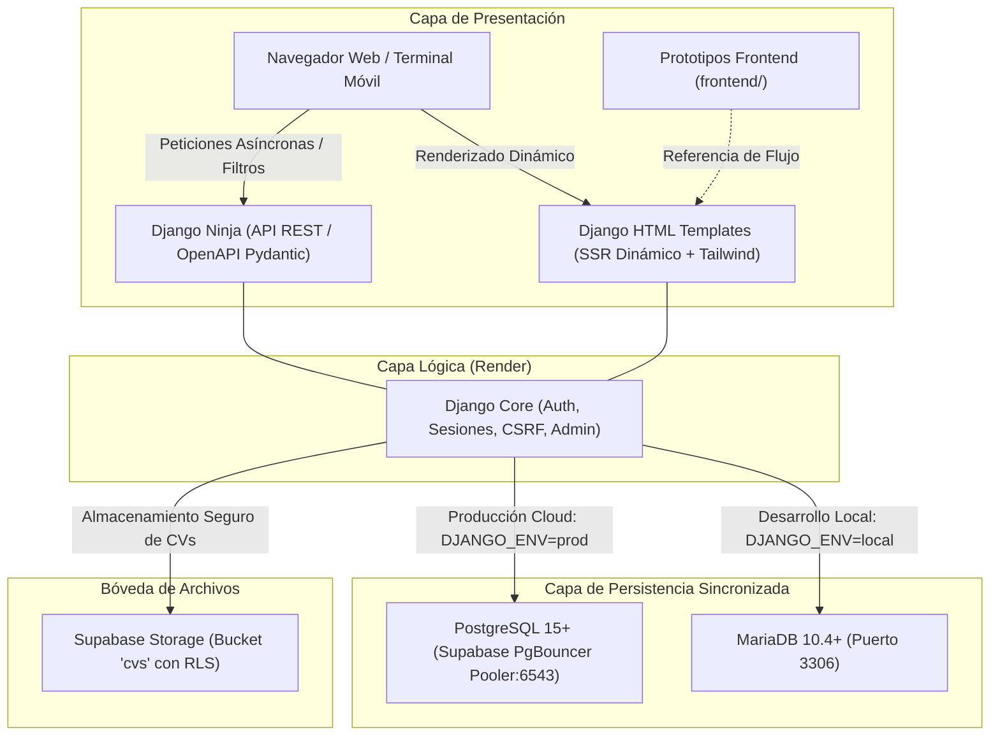

# 🎓 EmpleaTEC

> **Plataforma Integral de Conexión Laboral y Seguimiento de Egresados en TI**  
> *Instituto Tecnológico Superior de Naranjos (ITSNa) — Tecnológico Nacional de México (TecNM)*  
> **Materia:** Desarrollo de Emprendedores | **Docente:** Dra. Leonor Tomasa Hernández del Ángel  
> **Metodología de Ciclo de Vida:** Framework 6D (Cascada Estricta Agnóstica) | **Fase Activa:** `D2_DEFINIR` ➔ `D3_DISEÑAR`  

---

## 👥 Célula de Ingeniería y Desarrollo

* **Gerardo Aquino del Ángel** — *241H0327* (Frontend Lead & UX)
* **José Avilés Cárdenas** — *241H0226* (Arquitectura de Software & Backend Core)
* **Juan Hernández Montiel** — *241H0235* (Frontend & Integración de Vistas)
* **Fernando Alberto Martínez Rosas** — *241H0290* (DBA & Modelado de Datos)

---

## 🏛️ 1. Visión y Propósito del Proyecto

Actualmente, el proceso de seguimiento de egresados y vinculación laboral en el ITSNa opera de manera fragmentada a través de formularios manuales con tasas de respuesta inferiores al 15%. Este esquema genera tres fallas críticas:
1. **Desconexión con el sector tecnológico:** Los egresados carecen de una plataforma institucional centralizada para proyectar su perfil, portafolio, repositorios y certificaciones técnicas.
2. **Ceguera analítica para acreditación:** El instituto carece de telemetría salarial y métricas de empleabilidad en tiempo real, dificultando las auditorías de calidad de CACEI y TecNM.
3. **Fricción en el reclutamiento:** Las empresas de la región carecen de un canal directo y filtrado por competencias para reclutar talento calificado en Ingeniería en Sistemas Computacionales y TICs.

**EmpleaTEC** resuelve esta problemática como un sistema web (SaaS institucional) que vincula activamente a tres actores clave: **Egresados/Estudiantes**, **Empresas Empleadoras** y la **Oficina de Vinculación y Residencias del ITSNa**.

---

## ⚡ 2. Arquitectura Tecnológica y Stack Oficial

La arquitectura técnica se encuentra formalmente congelada bajo el registro arquitectónico **ADR 001**:



### Componentes Clave:
* **Backend y API:** **Django** (Python 3.11.5) + **Django Ninja**. Máxima velocidad de ejecución SSR, tipado estricto con Pydantic y generación automática de contratos OpenAPI (Swagger).
* **Frontend:** **Django Templates** con **HTML5 semántico**, micro-interacciones ágiles y utilidades **Tailwind CSS**.
* **Persistencia Dual Sincronizada:**
  * **Entorno Local (Desarrollo):** **MariaDB** (Motor InnoDB, dialecto MySQL).
  * **Entorno Cloud (Producción):** **PostgreSQL** sobre **Supabase** conectado a través del Transaction Pooler (`PgBouncer` en puerto `6543`).
  * *Compatibilidad ANSI-SQL:* Abstracción limpia mediante el ORM de Django con tipos universales para garantizar migraciones y pruebas idénticas en ambos motores.
* **Bóveda de Currículums:** **Supabase Storage**. Los documentos PDF se gestionan mediante identificadores únicos resguardados con firmas temporales y políticas de seguridad RLS.
* **Despliegue e Infraestructura:** Despliegue en **Render** (servicio web backend con Gunicorn) y vinculación con repositorio GitHub `AldraAV/EmpleaTEC`.

---

## 🎨 3. Ecosistema de Interfaz y Frontend

El desarrollo del frontend de EmpleaTEC se gestiona a través de una colaboración continua entre el equipo de diseño y maquetación:

### A. Prototipos Iniciales del Frontend (`frontend/`)
Aportados por la célula de Frontend liderada por **Gerardo Aquino**, estos archivos definen el wireframe inicial y los flujos indispensables para el MVP:
* **`frontend/formulario.html`:** Portada y Landing Page inicial del proyecto con menú de navegación institucional (`Inicio`, `Alumnos`, `Empresas`, `Nosotros`, `Contacto`, `Oficina`), encabezado de bienvenida y accesos directos de acción (`Publicar Oferta`, `Explorar Vacantes`).
* **`frontend/alumnos.html`:** Maqueta del directorio de egresados que valida la necesidad de presentar perfiles de candidatos con enlaces a su detalle profesional.
* **`frontend/empresas.html`:** Maqueta del directorio de empresas locales aliadas que demuestra la visualización de empleadores en convenio.

### B. Directiva Maestra de Diseño (`DIRECTIVA_LANDING_FRONTEND.md`)
Marco vinculante de estética y experiencia de usuario que guía la evolución visual de los prototipos:
* **Principio Sparkdesign:** Diseño colaborativo orientado a conectar de forma limpia y espaciosa a postulantes y empresas sin sobrecarga cognitiva.
* **Principio Cloudlight:** Tratamiento visual etéreo en la sección *Hero*, con fondos claros, iluminación ambiental suave y presencia de activos vectoriales minimalistas.
* **Activos Vectoriales Oficiales (`assets/`):**
  * Composición de Landing Page: [`assets/EmpleaTEC Landing Page with Minimalistic Illustration.svg`](file:///C:/Users/carde/Desktop/MUACK_2.0/Proyectos_escolares_504B/EmpleaTEC/assets/EmpleaTEC%20Landing%20Page%20with%20Minimalistic%20Illustration.svg)
  * Logotipo Maestro Vectorial: [`assets/Sleek Vector Logo with Interlocked Letters for EmpleaTEC.svg`](file:///C:/Users/carde/Desktop/MUACK_2.0/Proyectos_escolares_504B/EmpleaTEC/assets/Sleek%20Vector%20Logo%20with%20Interlocked%20Letters%20for%20EmpleaTEC.svg)
* **Las Santas Escrituras Tipográficas:**
  * **`Space Grotesk`:** Títulos de alto impacto, sección *Hero* y encabezados principales.
  * **`Inter`:** Lectura fluida, tablas de egresados, empresas y párrafos explicativos.
  * **`Poppins`:** Botones de acción, llamadas táctiles (*CTAs*) y elementos interactivos redondeados.
  * **`JetBrains Mono`:** Números de control escolar, RFCs corporativos, etiquetas técnicas y métricas.

---

## 🗄️ 4. Modelo de Datos y Validación Relacional (3FN)

El diseño de la base de datos se encuentra exhaustivamente documentado en [`docs/2_Define/ANALISIS_EXHAUSTIVO_MODELADO_BD.md`](file:///C:/Users/carde/Desktop/MUACK_2.0/Proyectos_escolares_504B/EmpleaTEC/docs/2_Define/ANALISIS_EXHAUSTIVO_MODELADO_BD.md) y esquematizado en el vector interactivo [`diagrama E-R empleaTEC.svg`](file:///C:/Users/carde/Desktop/MUACK_2.0/Proyectos_escolares_504B/EmpleaTEC/diagrama%20E-R%20empleaTEC.svg).

El modelo se articula en 5 dominios relacionales que respaldan exactamente las vistas del frontend:

| Dominio Relacional | Entidades Principales | Vista / Flujo de Usuario Asociado |
| :--- | :--- | :--- |
| **Identidad y Acceso** | `usuario`, `rol`, `sesion_usuario` | Autenticación y control de acceso RBAC para Egresados, Empresas y Administradores. |
| **Padrón y Egresados** | `catalogo_control_escolar`, `perfil_egresado`, `habilidad`, `certificacion` | Pantalla `alumnos.html` y registro blindado con validación de matrícula escolar oficial. |
| **Sector Productivo** | `empresa`, `convenio_vinculacion` | Pantalla `empresas.html` y validación de empresas legítimas por parte del instituto. |
| **Bolsa de Trabajo** | `vacante`, `vacante_habilidad`, `postulacion`, `seguimiento_postulacion` | Botones `Explorar Vacantes` y `Publicar Oferta` en la Landing Page. |
| **Gestión Institucional** | `encuesta_seguimiento`, `respuesta_encuesta`, `reporte_acreditacion` | Acceso `Oficina` en la barra de navegación para el personal de Vinculación ITSNa. |

---

## 💰 5. Modelo Económico y Viabilidad Financiera (Startup Bootstrapping)

En concordancia con los requerimientos académicos de la materia *Desarrollo de Emprendedores* y bajo la realidad de una startup tecnológica nacida en incubación estudiantil:

* **Inversión Real en Infraestructura Cloud:**
  * Servidor de Aplicación (Render Starter Web Service): **$1,680 MXN / año** ($7 USD/mes).
  * Dominio Institucional / Comercial (`empleatec.mx` / `.org`): **$420 MXN / año**.
  * Bóveda y Base de Datos Cloud (Supabase Tier Gratuito con 500MB y 1GB storage): **$0 MXN**.
  * Fondo de Soporte y Mantenimiento de Software: **$18,000 MXN / año** ($1,500 MXN/mes).
  * **Costo Operativo Anual Total:** **$20,100 MXN / año**.
* **Modelo de Ingresos (Freemium B2B):**
  * Egresados y Alumnos: Acceso 100% gratuito de por vida.
  * Empresas Locales (Convenio Base): Publicación gratuita de hasta 2 vacantes simultáneas.
  * Empresas Aliadas (Membresía B2B Anual): **$2,500 MXN / año** (destacado en bolsa de trabajo, acceso prioritario a perfiles certificados y analítica de candidatos).
* **Punto de Equilibrio (Break-Even):**
  $$\text{Punto de Equilibrio} = \frac{\$20,100 \text{ MXN}}{\$2,500 \text{ MXN/empresa}} \approx 9 \text{ empresas aliadas al año}$$
  Con solo **9 convenios empresariales activos**, EmpleaTEC cubre el 100% de su infraestructura técnica y gastos operativos.

*Consulte la guía forense de llenado del modelo financiero en [`docs/GUIA_MODELO_FINANCIERO_EXCEL_OMAR.md`](file:///C:/Users/carde/Desktop/MUACK_2.0/Proyectos_escolares_504B/EmpleaTEC/docs/GUIA_MODELO_FINANCIERO_EXCEL_OMAR.md).*

---

## 📂 6. Topología del Proyecto (Framework 6D)

Estructura viva y organizada del repositorio `AldraAV/EmpleaTEC`:

```
EmpleaTEC/
├── .project_state.json                       # Rastreador del estado del ciclo de vida 6D
├── README.md                                 # Manifiesto maestro y punto de entrada
├── DIRECTIVA_LANDING_FRONTEND.md             # Especificación técnica y visual de UI
├── index.html                                # Vista previa autónoma de la Landing Page
├── diagrama E-R empleaTEC.svg                # Diagrama vectorial interactivo de Base de Datos
├── assets/                                   # Biblioteca de activos gráficos, logos y mockups SVG/PNG
│   ├── EmpleaTEC Landing Page with Minimalistic Illustration.svg
│   ├── Sleek Vector Logo with Interlocked Letters for EmpleaTEC.svg
│   ├── logo.png
│   └── landing.png
├── frontend/                                 # Prototipos y wireframes estáticos del equipo de UI
│   ├── formulario.html                       # Wireframe de Landing Page y menú de navegación
│   ├── alumnos.html                          # Wireframe de listado de alumnos
│   └── empresas.html                         # Wireframe de listado de empresas
├── templates/                                # Plantillas SSR dinámicas de Django
│   └── index.html                            # Plantilla de Landing Page conectada a 
├── static/                                   # Hojas de estilo, scripts y assets servidos por Django
├── fuente_verdad/                            # Especificación académica original de la materia
│   └── Indice para Desarrolo emprendedores A y B_LTHDA_CASI_DEFINITIVO.md
└── docs/                                     # Documentación formal por fases de ingeniería 6D
    ├── GUIA_MODELO_FINANCIERO_EXCEL_OMAR.md  # Auditoría y guía de llenado de evaluación financiera
    ├── 1_Discovery/
    │   └── PRD.md                            # Product Requirements Document (Aprobado D1)
    ├── 2_Define/
    │   ├── ADR_001_Stack_Selection.md        # Registro de Decisión Arquitectónica (Stack Técnico)
    │   ├── Data_Architecture.md              # Modelo Entidad-Relación y Restricciones ANSI-SQL
    │   └── ANALISIS_EXHAUSTIVO_MODELADO_BD.md# Modelado relacional detallado en 3FN
    ├── 3_Design/                             # (En preparación: Topografía y Contratos de APIs)
    │   ├── Architecture_Topography.md
    │   └── Contracts_and_Interfaces.md
    ├── 5_Deploy/
    │   └── Runbook.md                        # Procedimientos de despliegue en Render/Supabase
    └── 6_Delivery/
        └── PostMortem.md                     # Retrospectiva final de entrega
```

---

## 🛠️ 7. Ruta de Ejecución Inmediata (Transición D2 ➔ D3)

1. **Refinamiento de la Landing Page:** Transformar la maqueta conceptual de `frontend/formulario.html` en una interfaz moderna, fiel a la composición vectorizada de `assets/` y con las fuentes oficiales.
2. **Modularización en Django Templates:** Estructurar `templates/base.html` con Navbar y Footer institucionales para que las vistas de `alumnos.html` y `empresas.html` hereden el mismo diseño.
3. **Formalización de Contratos de API (D3):** Registrar los esquemas Pydantic y endpoints de **Django Ninja** para la consulta de egresados y vacantes.

---

*Desarrollado con rigor técnico, excelencia estética y soberanía tecnológica en el ITSNa.* 🎓
